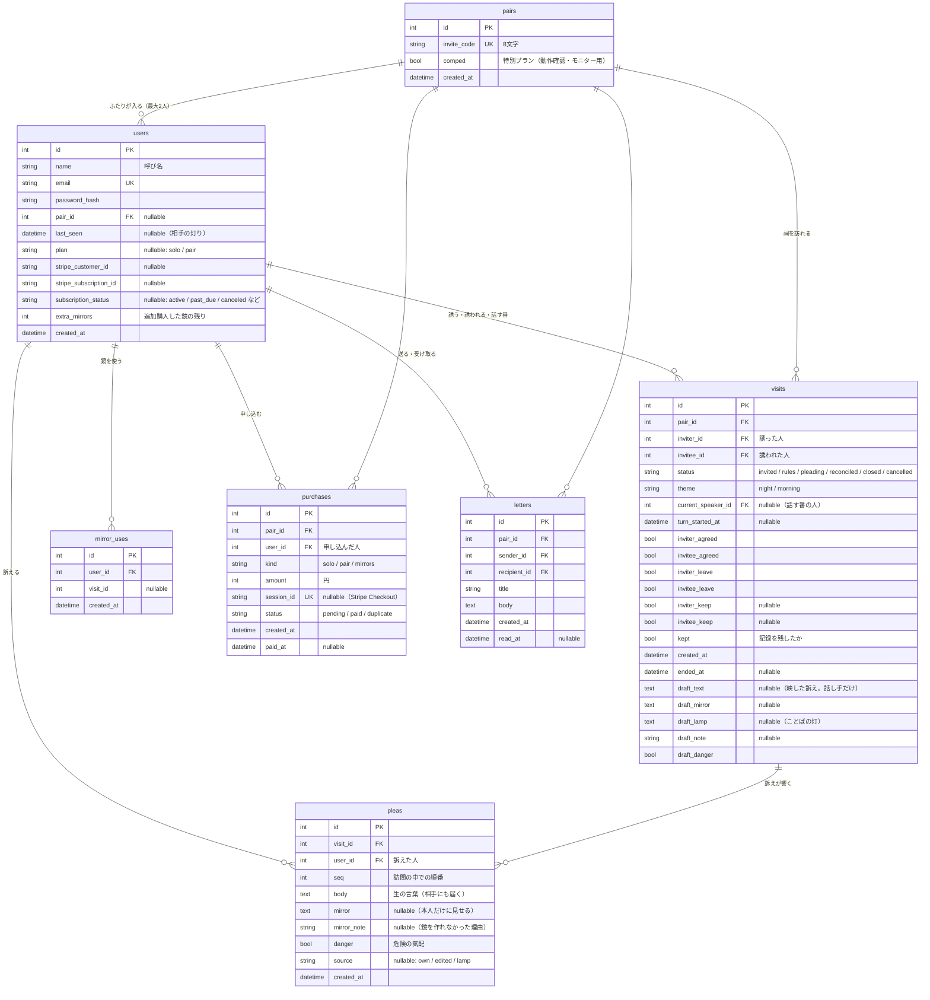
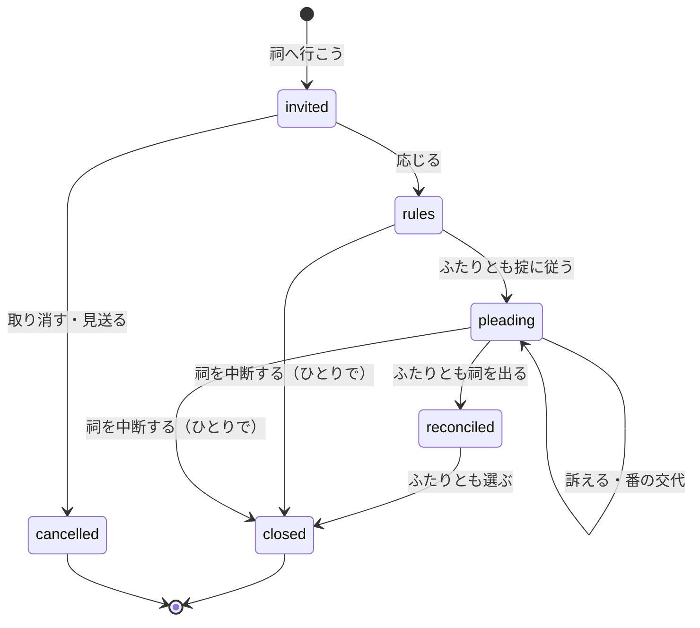

# データベース設計

## 前提

- Flask + Flask-SQLAlchemy（SQLAlchemy 2.x の `Mapped` / `mapped_column`）。定義は `sinden/models.py`
- DB は開発 **SQLite**（`instance/sinden.sqlite`、テストはメモリ上）、本番 **MySQL**（PyMySQL）。**文字列のカラムには長さを付け、SQLite 専用の SQL や関数を使わない**
- テーブルは7つ：`pairs`、`users`、`visits`、`pleas`、`mirror_uses`、`purchases`、`letters`
- 日時は日本時間（Asia/Tokyo）のまま、タイムゾーンなしで保存する。日本国内だけで使う前提。現在時刻は `models.now()` が Asia/Tokyo を明示して作る（サーバーの設定に頼らない。本番サーバーと MySQL も Asia/Tokyo）
- 外部キーに `ON DELETE CASCADE` は付けない。消すときはアプリが順番に消す（下の「削除したときの動き」）

## ER 図

## テーブル定義

### pairs（ふたり）

| カラム | 型 | 必須 | 説明 |
|-|-|:-:|-|
| id | int | ○ | 主キー |
| invite_code | String(12) | ○ | 招待コード（8文字、一意。0/O・1/I など見間違えやすい文字は使わない） |
| comped | Boolean | ○ | 支払いなしでプラン扱い（`flask set-premium` で切り替え）。既定 false |
| created_at | DateTime | ○ | |

- 「2人そろっているか」は `users` の数で判断する（2人になったら、その招待コードでは入れない）
- `Pair.is_premium`（ふたりで共有する機能を使えるか）= comped、またはどちらかのプランが有効

### users（ユーザー）

| カラム | 型 | 必須 | 説明 |
|-|-|:-:|-|
| id | int | ○ | 主キー |
| name | String(50) | ○ | 呼び名（相手に表示される） |
| email | String(255) | ○ | 一意。小文字にそろえて保存 |
| password_hash | String(255) | ○ | werkzeug のハッシュ |
| pair_id | int FK → pairs | | ペア。なければ null |
| last_seen | DateTime | | 祠の画面を開いている間、3秒ごとに更新 |
| plan | String(10) | | 自分で支払ったプラン（solo / pair） |
| stripe_customer_id | String(255) | | Stripe の顧客 |
| stripe_subscription_id | String(255) | | Stripe の月額契約 |
| subscription_status | String(30) | | Stripe の契約の状態（Webhook を受けて Stripe から取り直す）。active / trialing / past_due / unpaid / incomplete / paused / canceled / incomplete_expired |
| extra_mirrors | Integer | ○ | 追加購入した鏡の残り。既定 0 |
| created_at | DateTime | ○ | |

- `User.is_premium`（本人だけの機能を使えるか）= ペアが comped、または自分のプランが有効、または相手のふたりプランが有効

### visits（祠への1回の訪問＝1回の喧嘩）

| カラム | 型 | 必須 | 説明 |
|-|-|:-:|-|
| id | int | ○ | 主キー |
| pair_id | int FK → pairs | ○ | |
| inviter_id / invitee_id | int FK → users | ○ | 誘った人／誘われた人 |
| status | String(20) | ○ | 下の「状態の移り変わり」 |
| theme | String(10) | ○ | night（夜の祠）/ morning（ローマの朝） |
| current_speaker_id | int FK → users | | 話す番の人 |
| turn_started_at | DateTime | | 番が始まった時刻（残り時間の計算に使う） |
| inviter_agreed / invitee_agreed | Boolean | ○ | 掟に従ったか |
| inviter_leave / invitee_leave | Boolean | ○ | 「祠を出よう」と言ったか |
| inviter_keep / invitee_keep | Boolean | | 記録を残すか（未選択は null） |
| kept | Boolean | ○ | ふたりとも「残す」を選んだか |
| created_at / ended_at | DateTime | | |
| draft_text / draft_mirror / draft_lamp | Text | | 「ことばを確かめる」の下書き。**話し手にだけ見せる**。届けたとき・番が替わったときに消す |
| draft_note | String(200) | | 鏡を作れなかった理由 |
| draft_danger | Boolean | ○ | 危険の気配（あるときは灯を出さない） |

状態の移り変わり：

- 1組のペアで、続いている訪問（invited / rules / pleading / reconciled）は1つまで

### pleas（訴え）

| カラム | 型 | 必須 | 説明 |
|-|-|:-:|-|
| id | int | ○ | 主キー |
| visit_id | int FK → visits | ○ | |
| user_id | int FK → users | ○ | 訴えた人 |
| seq | Integer | ○ | 訪問の中での順番（1から） |
| body | Text | ○ | 生の言葉（3,000字まで）。相手にも見せる |
| mirror | Text | | 女神の鏡。**書いた本人にだけ見せる** |
| mirror_note | String(200) | | 鏡を作れなかった理由 |
| danger | Boolean | ○ | 危険の気配（言葉の確認か AI の判定） |
| source | String(10) | | 届けた言葉の選び方：own（自分の言葉のまま）/ edited（映したあと直した）/ lamp（ことばの灯） |
| created_at | DateTime | ○ | |

### mirror_uses（女神の鏡を使った記録）

| カラム | 型 | 必須 | 説明 |
|-|-|:-:|-|
| id | int | ○ | 主キー |
| user_id | int FK → users | ○ | 使った人 |
| visit_id | Integer | | どの訪問で使ったか（1回の祠の上限に使う。訪問が消えても残すため外部キーにしない） |
| created_at | DateTime | ○ | 月の回数を数える |

- 訴えを削除しても、この記録は残す（回数を正しく数えるため）
- 鏡が作れたときだけ記録する（失敗したら回数は減らない）

### purchases（支払いの申し込み）

| カラム | 型 | 必須 | 説明 |
|-|-|:-:|-|
| id | int | ○ | 主キー |
| pair_id | int FK → pairs | ○ | |
| user_id | int FK → users | ○ | 申し込んだ本人（完了画面はこの人だけ開ける） |
| kind | String(20) | ○ | solo（個人 500円/月）/ pair（ふたり 800円/月）/ mirrors（鏡の追加10回 100円） |
| amount | Integer | ○ | 円。サーバーの設定から決める |
| session_id | String(255) | | Stripe Checkout Session の ID（一意） |
| status | String(20) | ○ | pending / paid / duplicate（契約中に2つ目の月額が支払われた。上書きせず、運営者が返金する） |
| created_at / paid_at | DateTime | | |

- 支払いの確定は、完了画面での確認と Webhook の両方で行う。`pending` を `paid` に変えられた方だけが反映する（条件付き UPDATE）。何度届いても結果が同じ
- 契約の状態（`users.subscription_status`）は、Webhook を受けたら Stripe から取り直した値で上書きする。canceled・incomplete_expired になったあとは変えない（要件の「プランと契約の状態」）

### letters（手紙）

| カラム | 型 | 必須 | 説明 |
|-|-|:-:|-|
| id | int | ○ | 主キー |
| pair_id | int FK → pairs | ○ | |
| sender_id / recipient_id | int FK → users | ○ | 送った人／受け取った人 |
| title | String(100) | ○ | |
| body | Text | ○ | 5,000字まで |
| created_at | DateTime | ○ | |
| read_at | DateTime | | 受け取った人が開いた時刻 |

## 削除したときの動き

| 何を | どうなる |
|-|-|
| 記録を「残さない」 | その訪問の `pleas` を全て削除する。`visits` は状態 closed・kept=false で残す（いつ和解したかだけ残る）。`mirror_uses` は残す |
| 祠を中断する | 「残さない」と同じ。`pleas` を削除、`visits.draft_*` を消し、closed・kept=false |
| 退会（`auth.delete_account`） | 1つのトランザクションで次の順に消す：① ペアの `pleas` ② ペアの `visits` ③ ペアの `letters` ④ 本人の `mirror_uses` ⑤ 本人の `purchases` ⑥ ペアに誰も残らなければ、ペアの `purchases` と `pairs`。残るなら `pairs.invite_code` を作り直す ⑦ 本人の `users` |

- 退会しても、相手の `users` と `mirror_uses`・`purchases` は残す
- Stripe 側の顧客・支払いの記録は消さない（API を呼ばない）。`users.stripe_*` は行ごと消える

### 誰が読めるか（列ごと）

| 列 | 読める人 |
|-|-|
| `pleas.body` | ペアの2人 |
| `pleas.mirror`・`mirror_note`・`danger` | 書いた本人だけ |
| `visits.draft_text`・`draft_mirror`・`draft_lamp`・`draft_note`・`draft_danger` | 話し手本人だけ（自分の番の間） |
| `letters.*` | 送った人と受け取った人 |
| `users.email`・`stripe_*` | 本人だけ（相手には呼び名だけ見せる） |

## マイグレーション

1. `create tables`：7つのテーブルを作る
2. `per user plans`：プランをペアから人に移す。`mirror_uses` を1人ずつ数える形に作り直す（公開前のため）
3. `extra mirrors`：`users.extra_mirrors` を追加
4. `drafts and lamp`：`visits.draft_*` と `pleas.source` を追加
