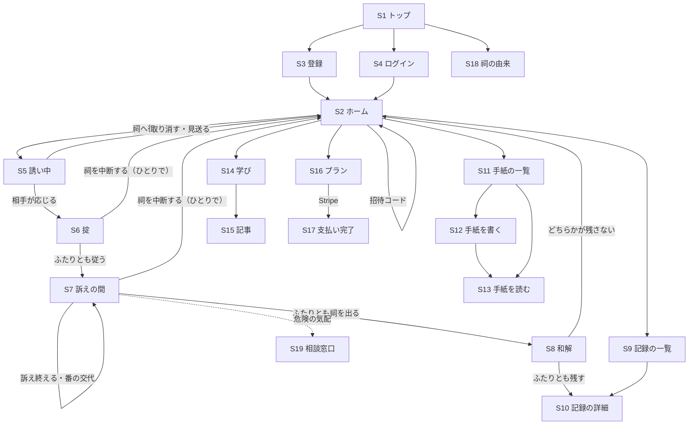

# 画面設計

> 要件は [docs/spec/requirements.md](../spec/requirements.md)。

## 画面一覧

| 画面名 | URL | ログイン | 使える人 | 表示するもの・できること |
|-|-|:-:|-|-|
| S1 トップ | `/` | 不要 | 未ログイン | 夜の祠に近づく演出、アプリ名（中央に大きく）、キャッチコピー（アプリ名より小さく）、祠の掟、顔のない女神、ひとりずつ（灯りの入れ替わり）、できること、登録ボタン |
| S2 ホーム | `/` | 必要 | ログインユーザー | ペアがない：招待コードを作る／入力する。相手待ち：招待コード。ペアあり：「祠へ行こう」（版を選ぶ）、届いた誘い（応じる／見送る）、続いている祠へ戻る、未読の手紙、鏡の残り回数 |
| S3 登録 | `/register` | 不要 | 未ログイン | 呼び名、メール、パスワード（8文字以上） |
| S4 ログイン | `/login` | 不要 | 未ログイン | メール、パスワード。「パスワードの再設定はできません（忘れたときは、新しく登録し直してください）」の一文 |
| S5 祠：誘い中 | `/shrine/<id>` | 必要 | ペアの2人 | 誘った人：「誘いを取り消す」。誘われた人：「応じて祠へ入る」「いまは見送る」 |
| S6 祠：掟 | `/shrine/<id>` | 必要 | ペアの2人 | 近づく演出（1回だけ。夜の祠は、真っ暗な幕が7秒かけて消え、暗闇から浮かび上がる）、掟4つ、女神の鏡の説明、「掟に従う」、「祠を中断する」（ひとりで終えられる） |
| S7 祠：訴えの間 | `/shrine/<id>` | 必要 | ペアの2人 | 女神の像とふたりの灯り（話す番は強く光り「話す」、聴く側は控えめに「聴く」）。話す番 ①：残り時間（0になったら「1分以内に押せば届く」と出す。自動では届けない）、大きなマイクボタン（プラン）、入力欄、「ことばを確かめる」「このまま届ける」（空のままでは届けられない）。話す番 ②（映したあと）：女神の鏡、ことばの灯、「ことばの灯の言い方で届ける」、自分の言葉の入力欄と「自分の言葉で届ける」。聴く番：「いまは聴く番です」、残り時間。共通：祠に響いた言葉、自分の鏡（本人だけ）、「祠を出よう」、「祠を中断する」（確認つき）。**危険の気配があるとき（書いた本人だけ）**：届ける前は下書きの横に、届けたあとは自分の鏡の欄に、相談窓口・「女神の判定は完全ではありません」・「祠を中断する」を出す。灯は出さない。聴く側には何も出さない |
| S8 祠：和解 | `/shrine/<id>` | 必要 | ペアの2人 | 「ふたりの選択：和解」、記録を「残す／残さない」。「残さない」を押すと、相手の返事を待たず、その場で訴えを消して終わる |
| S9 記録の一覧 | `/records/` | 必要 | ペアの2人 | 残した和解を新しい順に。無料は直近3件、それ以前は件数とプランの案内 |
| S10 記録の詳細 | `/records/<id>` | 必要 | ペアの2人（他人は 403） | 訴えの言葉、自分の鏡（相手の鏡は出さない）、「ふたりの選択：和解」 |
| S11 手紙の一覧 | `/letters/` | 必要 | ペアの2人 | 届いた手紙（未読の印）、送った手紙（既読／未読）、「手紙を書く」（プランの人だけ） |
| S12 手紙を書く | `/letters/new` | 必要 | プランの人 | 書き方のヒント（DESC法・Iメッセージ）、題名、本文 |
| S13 手紙を読む | `/letters/<id>` | 必要 | 送った人・受け取った人（他人は 403） | 便箋の形で表示、「PDF に保存・印刷する」。受け取った人が開くと既読になる |
| S14 学びの一覧 | `/learn/` | 不要 | 誰でも | 12記事（巻 I〜XII）。無料の印、プランの印 |
| S15 学びの記事 | `/learn/<slug>` | 不要 | 誰でも（プラン記事の全文はプランの人だけ） | 本文、言い換えの例の表。読めないときは最初の段落とプランの案内 |
| S16 プラン | `/billing` | 必要 | ペアのメンバー | 今のプラン、鏡の残り回数、無料と個人・ふたりの比較表、申し込みボタン、鏡の追加購入、解約・カードの変更 |
| S17 支払い完了 | `/billing/complete?session_id=...` | 必要 | 申し込んだ本人（他人は 403） | Stripe から戻る画面。「ありがとうございます」／未確定なら「確認しています」 |
| S18 祠の由来 | `/about` | 不要 | 誰でも | ヴィリプラカの祠の話、顔のない女神、名前の由来、出典 |
| S19 相談窓口 | `/help` | 不要 | 誰でも | 安全を優先してほしいこと、相談窓口の一覧（暴力・脅し・支配の窓口と、「気持ちがつらいとき」の窓口）、「祠の判定は完全ではないので、表示がなくても危険を感じたら相談を」 |
| S20 プライバシーポリシー | `/privacy` | 不要 | 誰でも | 預かる情報、外のサービスへ送るもの（Claude API・Stripe・ブラウザの音声認識・Google Fonts / jsDelivr）、見られる人、消し方、問い合わせ（Google フォーム） |
| S21 利用規約 | `/terms` | 不要 | 誰でも | 祠は話し合いを助ける場であること、禁止事項、料金（現在は Stripe のテストモード）、変更・停止 |
| S22 退会 | `/account/delete` | 必要 | ログインユーザー（プラン契約中は S16 へ戻す） | 消えるもの、パスワード、確認の印、「退会する」。退会後はログアウトしてトップへ。**相手の見え方**：S2 ホームは「相手を待っている」状態（新しい招待コード）、S9・S11 は空、祠を開いていれば次の確認でホームへ |

S5〜S8 は同じ URL で、祠の状態（`Visit.status`）によってテンプレートを切り替える（`shrine/<status>.html`）。終わった祠を開くと、記録を残した場合は S10、残さなかった場合はホームへ移る。

## 画面ではない URL

値を変える操作は全て POST（CSRF トークン付き）。

| URL | メソッド | 使える人 | すること |
|-|-|-|-|
| `/manifest.webmanifest` | GET | 誰でも | ホーム画面に追加するための情報（PWA）。アイコンは `static/icons/` |
| `/logout` | POST | ログインユーザー | ログアウト |
| `/pair/create` | POST | ペアのない人 | 招待コードを作る |
| `/pair/join` | POST | ペアのない人 | 招待コードでペアになる（2人そろったペアには入れない） |
| `/shrine/invite` | POST | ペアのメンバー | 祠に誘う（版は誘った時刻で自動に決まる。18:00〜翌5:00 は夜、5:00〜18:00 は朝。どちらも無料） |
| `/shrine/<id>/accept` | POST | 誘われた人 | 応じる（invited → rules）。誘って24時間たった誘いは、取り消し（cancelled）になっていて応じられない |
| `/shrine/<id>/cancel` | POST | ペアの2人 | 誘いを取り消す／見送る（invited → cancelled） |
| `/shrine/<id>/agree` | POST | ペアの2人 | 掟に従う。ふたりそろうと訴え始め（誘われた側から） |
| `/shrine/<id>/reflect` | POST | **話す番の人だけ** | ことばを確かめる。鏡と灯を作り、下書きに置く（相手には届かない。1回の番で1回まで） |
| `/shrine/<id>/plea` | POST | **話す番の人だけ** | 届ける（`source=lamp` なら灯の言い方）。番を交代し、下書きを消す。空のときは届けず、番も替えない |
| `/shrine/<id>/plea` の確認 | POST | **話す番の人だけ** | 強い言葉を含む訴えは、届ける前に「女神の灯が揺れる」確認の画面を返す（本人にだけ）。`confirm=1` で届ける。`rewrite=1` で、書いた言葉を残したまま書き直す画面に戻る |
| `/shrine/<id>/extend` | POST | **話す番の人だけ** | 「もう少し、待ってください」。番ごとに1回だけ、持ち時間をあと5分延ばす |
| `/shrine/<id>/react` | POST | **話す番の人だけ** | リアクション（`key` は決まった5つのみ。それ以外は 400）。決まったことばを訴えとして残し、番を交代する。AI は使わない |
| `/shrine/<id>/leave` | POST | ペアの2人 | 祠を出よう（`stay=1` で取り消し）。ふたりそろうと和解 |
| `/shrine/<id>/stop` | POST | ペアの2人（**ひとりで**） | 祠を中断する（掟・訴えの間）。closed・記録は残さない。訴えと下書きを消す |
| `/shrine/<id>/keep` | POST | ペアの2人 | 記録を残す／残さない。「残さない」は、相手の返事を待たずに終了して訴えを消す（「残す」は、ふたりそろったとき残る） |
| `/shrine/<id>/state` | GET | ペアの2人（別のペアは 403、祠が消えていたら 404、相手が退会してペアがそろっていなければホームへ転送） | 3秒ごとに呼ばれる（JSON）。返すのは `version`・`partner_present`・`remaining` だけ。本文・下書き・鏡・灯・危険の気配は返さない |
| `/home/state` | GET | ペアのメンバー | ホームで5秒ごとに呼ばれる（JSON）。相手の参加・誘い・取り消しがあれば画面を作り直す（祠に入るのは「応じる」を押したときだけ） |
| `/billing/checkout/<kind>` | POST | ペアのメンバー | `solo`／`pair`／`mirrors` の決済ページへ（Stripe） |
| `/billing/portal` | POST | 契約している本人 | 解約・カード変更の画面へ（Stripe） |
| `/webhooks/stripe` | POST | Stripe | 支払いの確定、契約の変更・解約を受け取る（CSRF の対象外。署名を確かめる） |

## 画面の遷移

## 2人の画面の同期

- S5〜S8 の画面は、3秒ごとに `/shrine/<id>/state` を呼ぶ
- 返ってきた `version`（状態・話し手・訴えの数・ふたりの意思表示から作る値）が変わっていたら、画面を読み込み直す
- 入力中の文章は、読み込み直しても消えないようにブラウザ（`sessionStorage`）に一時保存する。キーは利用者・祠・番ごと。届けたとき・ログアウトしたときに消す
- `/state` が 404（祠が消えた）か、ホームへの転送（相手の退会でペアがそろわなくなった）を返したら、ホームへ移る
- 画面を作り直すとき、サーバーは本人の分だけを HTML に入れる（相手の下書き・鏡・灯・危険の気配は、聴く側の HTML に入らない）
- `/state` を呼ぶたびに `users.last_seen` を更新する。相手の `last_seen` が10秒以内なら相手の灯りをともす
- 持ち時間が0になっても、画面は自動では届けない。「持ち時間です。1分以内に押せば届きます」と出す
- 話し手が画面を閉じたまま、または届けないまま、持ち時間（5分）を60秒過ぎたら、番を相手に渡す（書きかけの文は届かない）
